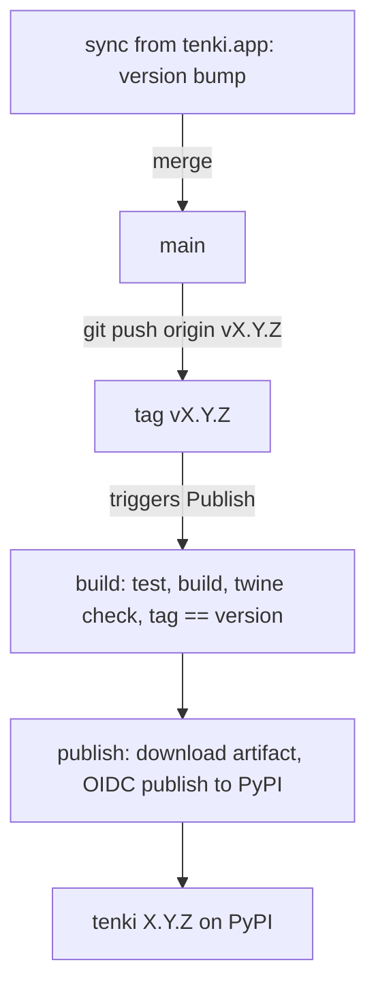

# Release Process

How a version of the `tenki` SDK is published to PyPI. A release is an
immutable artifact: a git tag `vX.Y.Z` and the matching
[`tenki` X.Y.Z](https://pypi.org/project/tenki/) on PyPI. Pushing the tag is the
only thing that publishes.

## How a version number is chosen

You do not hand-pick a version in this repository. The version in
`pyproject.toml` is owned upstream and lands here through a
`sync from tenki.app@<sha>` commit on `main` (for example `1.4.0 → 1.4.1`). A
release tag always matches whatever `pyproject.toml` says on the commit being
tagged — the publish workflow fails the release if they disagree.

## How to cut a release

Once the version you want to ship is on `main` (its `sync` commit has merged):

```bash
git checkout main && git pull --ff-only
git tag v1.4.1          # must equal the pyproject.toml version on this commit
git push origin v1.4.1
```

Pushing the `v*` tag triggers the **Publish** workflow. It runs the tests, builds
the package, checks it, verifies the tag matches the packaged version, and then
publishes to PyPI. If that version is already on PyPI the publish is skipped, so
re-pushing a tag is safe.

That is the whole job: push the tag.

## Who can release

Publishing is gated on **who can push a `v*` tag**, not on who can run a
workflow:

- A **tag ruleset** (`v*`, _Restrict creations_) limits tag creation to the
  release managers on its bypass list. That list is the publish allowlist.
- The **`pypi-publish` environment** is restricted to `v*` tags and is the only
  thing bound to PyPI's OIDC trusted publisher.
- Publishing uses **PyPI Trusted Publishing** (OIDC) — there is no long-lived API
  token to leak, and the publish job mints a short-lived token scoped to this
  workflow and environment. The upload is signed with PEP 740 attestations.

## Dry run

Running the **Publish** workflow manually (`workflow_dispatch`, from the Actions
tab) builds, tests, and `twine check`s the package but **never publishes**. Use
it to validate a build before tagging. Only a `v*` tag push can publish.

## The flow end to end



## The workflows

| Workflow | File | Trigger | What it does |
|----------|------|---------|--------------|
| Test | `.github/workflows/test.yml` | every PR; push to test paths; manual dispatch | runs the protobuf-compatibility matrix; a `Test` gate reports on every PR |
| Publish | `.github/workflows/pypi-publish.yml` | `v*` tag push (publishes); `workflow_dispatch` (dry run) | builds and checks the package, then publishes the tested artifact to PyPI |

## How the published bytes are the tested bytes

The **Publish** workflow is split in two jobs. The `build` job tests, builds, and
`twine check`s the package, then uploads `dist/` as an artifact. The `publish`
job — the only one holding `id-token: write` and bound to the `pypi-publish`
environment — downloads that exact artifact and publishes it. It runs no
checkout, `pip install`, or build, so no freshly resolved code executes in the
job that can mint a trusted-publisher token, and what reaches PyPI is byte-for-byte
what was tested.
